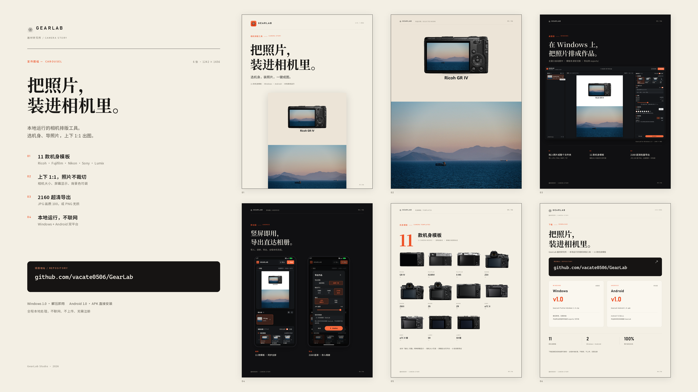
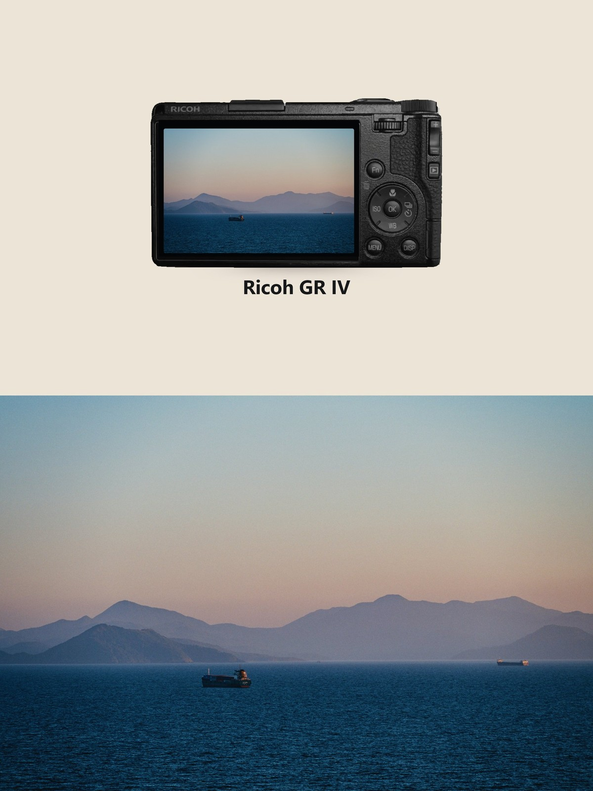
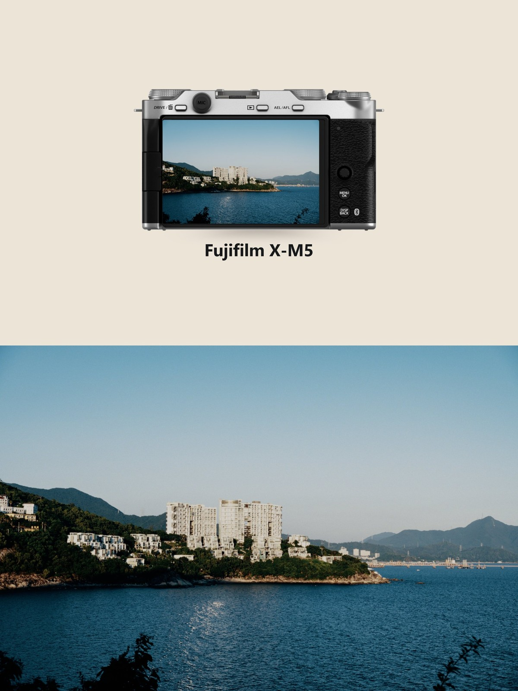
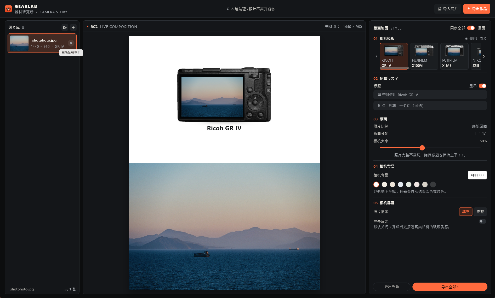

# GearLab 器材研究所

> 把照片，装进相机里

GearLab 是一个本地运行的相机排版工具。选择相机模板、导入照片，它会生成一张「器材 + 成片」的作品图：上方是相机与屏幕里的照片，下方是完整成片。上下严格 1:1，照片不裁切、不拉伸、不留白边。

当前版本 **1.0**，提供 **Windows** 与 **Android** 两个平台。所有处理都在本机完成，不联网、不上传、不需要账号。



## 示例展示

以下四张作品均由 GearLab 生成：

<table>
  <tr>
    <td width="50%" align="center"><br /><sub><b>Ricoh GR IV</b></sub></td>
    <td width="50%" align="center"><br /><sub><b>Fujifilm X-M5</b></sub></td>
  </tr>
</table>




## 下载

| 平台 | 安装包 |
|---|---|
| Windows | [GearLab-Flutter-Windows-1.0.zip](dist/GearLab-Flutter-Windows-1.0.zip) |
| Android | [GearLab-Android-1.0.apk](dist/GearLab-Android-1.0.apk)（Android 7.0 / API 24+） |
| 校验值 | [SHA256SUMS-Flutter.txt](dist/SHA256SUMS-Flutter.txt) |

- Windows：解压后保留 `GearLab-Windows-1.0` 文件夹，运行其中的 `GearLab.exe`。
- Android：APK 为 release 构建、调试签名，可直接安装测试；正式分发前请替换为正式签名。

## 功能


## 相机模板

内置 **11 款**机身模板，支持「填充 / 完整」两种显示方式；屏幕反光默认关闭。相机大小可调，默认 50%


### 版式与文字

- 上方器材区与下方照片区严格 1:1。
- 下方照片完整展开，不裁切、不拉伸。
- 标题、副标题可编辑，标题可隐藏；隐藏后版面仍保持上下 1:1。
- 标题颜色根据背景自动选择深色或浅色。

### 背景颜色

- 8 个常用背景色预设。
- 浅色 HSV 颜色选择器：色相、饱和度、明度、不透明度、HEX。
- HEX 色块直接显示当前颜色，例如 `#FFFFFF` 显示为白色。

### 照片库

- 支持 JPG / PNG / BMP / TIF / TIFF
- Windows 支持拖拽照片或文件夹导入

### 同步与逐张编辑

- 「同步全部」默认开启：相机模板、标题文字、版面、背景、屏幕设置作用于全部照片。
- 关闭后，每张照片可保存自己的相机与版式设置。
- 关闭应用重新打开，自动恢复上次编辑状态：照片库、选中照片、相机模板、标题、颜色、屏幕设置和同步开关

### 导出

- 默认导出 **全部照片**，可手动切换为当前单张
- 默认 2160 超清、JPG 画质 100
- 可选 1080 / 1440 / PNG
- Windows：固定导出到应用文件夹外层的 `exports/`
- Android：固定保存到系统相册 `Pictures/GearLab`

## 平台说明

### Windows

- 主窗口每次启动自动居中。
- 相机模板条支持左右箭头、鼠标滚轮和拖动浏览。
- 支持拖拽文件/文件夹导入。
- 导出目录固定为解压目录下、与 `GearLab-Windows-1.0` 同级的 `exports/`。
- 编辑状态保存在应用目录的 `userdata/`。

### Android

- 竖屏自适应布局。
- 预览标题只保留「预览」。
- 导出面板默认「全部照片」，不显示多余说明文字。
- 导出到系统相册，可在相册的 GearLab 相簿中查看。
- 编辑状态保存在应用私有目录。

## 使用流程

1. 打开 GearLab。
2. 点击「导入照片」，Windows 也可直接拖入照片或文件夹。
3. 选择相机模板，调整标题、背景、版面和相机大小。
4. 点击「导出作品」，选择范围与尺寸。
5. Windows 在 `exports/` 查看结果；Android 在系统相册的 `GearLab` 相簿查看。

## 源码与构建

Flutter 工程位于 [`flutter_app/`](flutter_app/README.md)。

```powershell
cd flutter_app
flutter pub get
flutter build windows --release
flutter build apk --release
```

环境要求：

- Flutter 3.50+ / Dart 3.14+
- Windows：Visual Studio 2022 C++ 桌面开发工具链
- Android：Android SDK 36、JDK 17+

## 目录结构

```text
GearLab/
  flutter_app/          Flutter 源码、相机模板与构建配置
  docs/examples/        示例作品图
  dist/                 Windows ZIP、Android APK、SHA-256
  README.md
  LICENSES.md
```

## 授权

相机模板来自用户提供的素材，商标归各自权利人所有。应用代码与图标授权说明见 [`LICENSES.md`](LICENSES.md)。

当前项目只维护 Flutter 实现。
