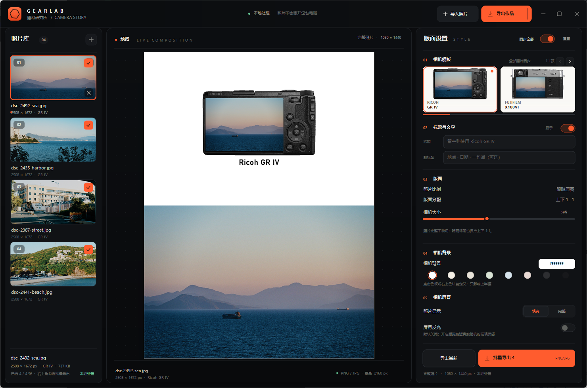
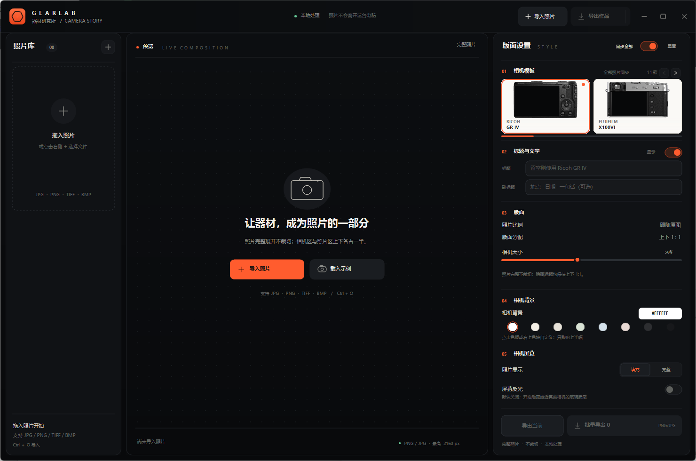
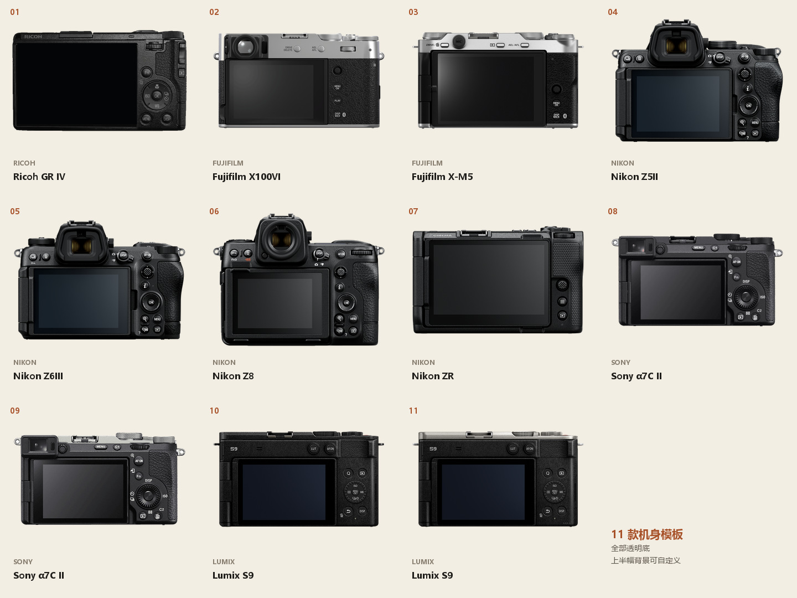
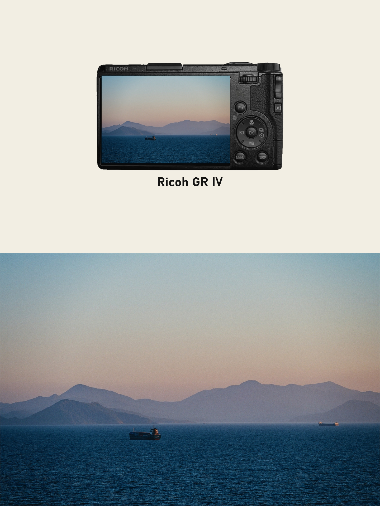
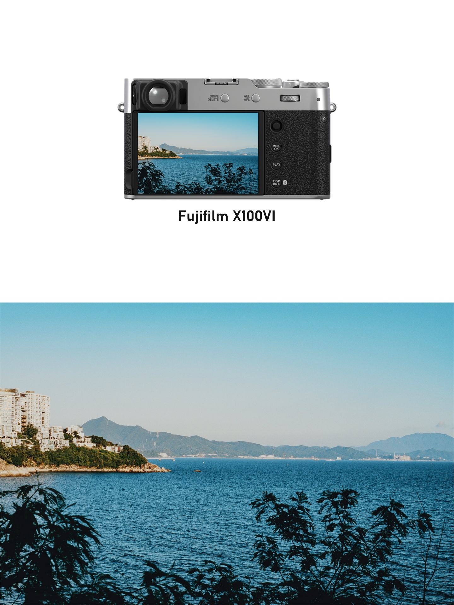
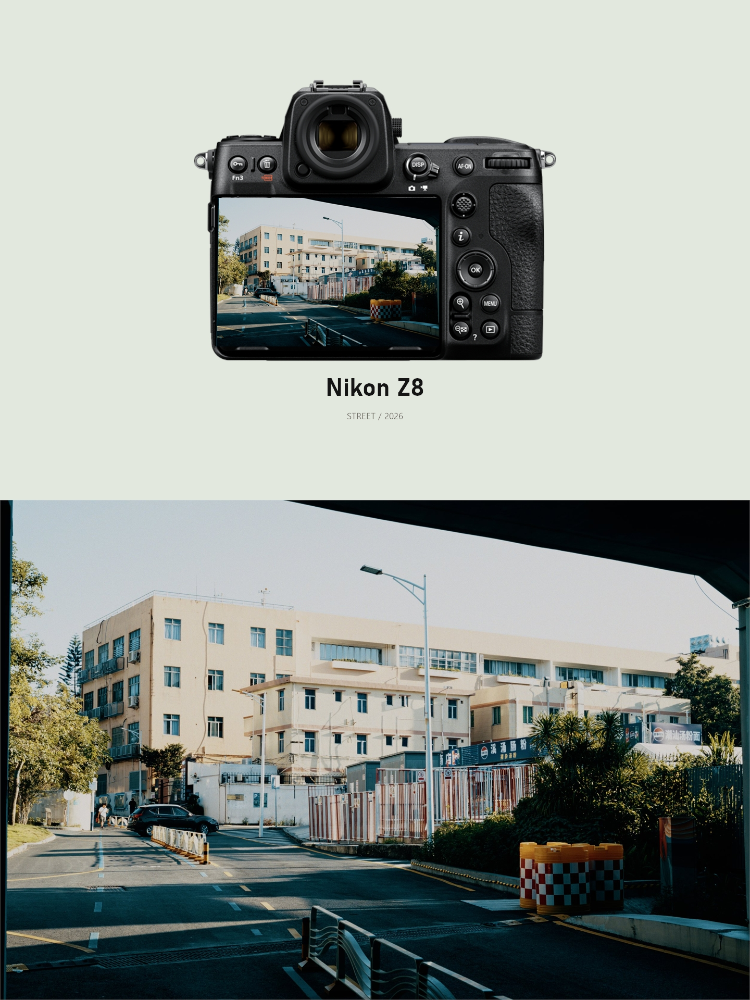
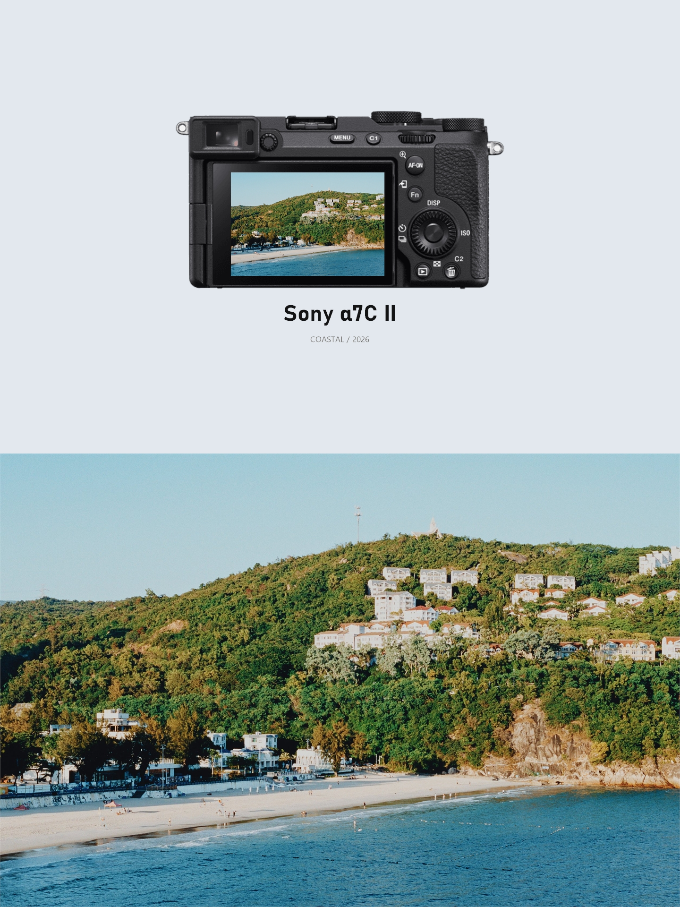

# GearLab 器材研究所

> 把照片，装进相机里

GearLab 是一款面向摄影爱好者的 Windows 本地排版工具：选择一台相机，导入你的照片，生成一张「器材 + 成片」的分享图。相机与标题占上半幅，照片按原图完整展开在下半幅；两块区域严格保持 1:1，照片不裁切、不留白边

所有处理都在本机完成，不联网、不上传、不需要账号。



## 下载与运行

| 文件 | 说明 |
|---|---|
| [GearLab-Windows-1.3.0.zip](dist/GearLab-Windows-1.3.0.zip) | 免安装 Windows 版，解压后运行 `GearLab.exe` |
| [GearLabCLI.exe](windows/dist/GearLabCLI.exe) | 命令行批处理工具 |

要求：Windows 10 / 11，系统自带的 .NET Framework 4.8。程序没有代码签名，首次运行如遇 SmartScreen，请选择「更多信息 → 仍要运行」。

## 界面

首次打开：



照片库右上角勾选批量照片；底部提供「导出当前」与「批量导出 N」两个入口。导出面板里也可以切换范围，默认保存到程序文件夹下的 `exports/`。

## 相机模板

内置 **11 款**机身模板，全部来自本地模板照片，已做透明背景处理：Ricoh GR IV、Fujifilm X100VI、Fujifilm X-M5、Nikon Z5II / Z6III / Z8 / ZR、Sony α7C II、Lumix S9。



相机模板在右侧单行横向排列，用 `‹` / `›` 或鼠标滚轮切换；当前机身会在屏幕里实时合成照片。

右上角有 **「同步全部」** 开关，**默认开启**。开启时，相机模板、标题与文字、版面、相机背景、相机屏幕的修改会应用到所有照片；关闭后，这些设置只作用于当前照片，切换照片会恢复各自的设置。批量导出时，每张照片也使用自己保存的完整设置。

| Ricoh GR IV | Fujifilm X100VI | Nikon Z8 | Sony α7C II |
|---|---|---|---|
|  |  |  |  |

> 上表是关闭「同步全部」后，为四张照片分别指定不同机身的效果；默认开启同步时，四张照片共用同一套设置。

### 相机背景颜色

上半幅的背景颜色可以自定义：右侧「相机背景」提供 8 个预设色板；点最右侧的十六进制色块可以打开系统取色器，选择任意颜色。标题文字会自动切换明暗以保证对比度，下半幅照片不受影响。

## 功能

### 相机与照片

- 导入 JPG / JPEG / PNG / BMP / TIF / TIFF，自动尊重 EXIF 方向。
- 当前照片会实时合成到所选相机的屏幕中；画面下方使用同一张照片完整显示。
- 相机屏幕支持「填充画面」与「完整照片」两种显示方式。
- **屏幕反光默认关闭**，需要玻璃质感时可在设置里打开。
- 缩略图、当前照片和相机模板卡片都会随导入和选择即时更新。
- **「同步全部」默认开启**：相机模板、标题与文字、版面、相机背景、相机屏幕的修改应用到所有照片。
- 关闭「同步全部」后，每张照片独立保存这些设置；照片库缩略图会显示各自机型，切换照片时右侧设置自动跟随。
- **11 款模板照片**均已抠除白底，可放在任意自定义背景色上。

### 版面

- 照片按原图宽高比**完整显示**，不裁切、不拉伸，也不加白边。
- 上方相机区与下方照片区**上下各占一半高度（1:1）**。
- **隐藏标题不会缩小顶部**：无论显不显示标题，上下仍保持 1:1。
- 成品总高度 = 2 × 照片在目标宽度下的完整高度，会自动适配横图 / 竖图 / 方图。
- 相机大小可调（34%–72%）；默认 50%，相机会在固定的上方区域内自动缩放。
- **上半幅背景可自定义**：8 个预设色板 + 系统取色器；标题颜色自动适配明暗背景。
- 标题留空时自动使用相机型号，也可以输入中文或英文标题与副标题。
- 开关标题显示；一键重置全部版面设置。
- 导出宽度 1080 / 1440 / 2160 px，**默认 2160（超清）**；高度按每张照片自动计算。

### 导入与导出

- 文件对话框导入，也支持把文件或文件夹拖进窗口。
- 照片库显示编号、文件名、尺寸和文件大小；`Del` 从库中移除（不会删除原图）。
- **单个导出**：右下角「导出当前」只导出当前照片。
- **批量选择导出**：点每张缩略图右上角的勾选框，再点「批量导出 N」只导出勾选的照片。
- 批量导出时，**每张照片使用自己保存的完整设置**（相机、标题、版面、背景、屏幕）；同步全部开启时这些设置相同。导出面板里也可以切换「当前单张 / 已选 N 张」。
- **JPG 默认画质 100（最高质量、最低压缩）**，也可调低；真正无损请选 PNG。
- 自动避免覆盖同名文件；完成后可一键打开导出目录。
- 默认导出目录：程序文件夹下的 `exports/`（即项目/解压目录内），不可写时才回退到 `图片/GearLab`。

### 隐私

- 不申请网络权限，不上传照片，不包含遥测。
- 原图只读，所有渲染和 JPG/PNG 编码都在本机内存中完成。
- 程序只写入选定的导出目录；载入示例时会在程序目录或系统临时目录释放内置样片。

## 快捷键

| 快捷键 | 功能 |
|---|---|
| `Ctrl + O` | 导入照片 |
| `Ctrl + E` / `Ctrl + S` | 打开导出面板 |
| `Del` | 从照片库移除当前照片 |
| `←` / `→` | 上一张 / 下一张 |
| `F11` | 最大化 / 还原 |
| `Esc` | 关闭导出面板 |
| `Enter` | 在导出面板中开始导出 |

## 使用步骤

1. 解压 `GearLab-Windows-1.3.0.zip`，双击 `GearLab.exe`。
2. 点「导入照片」，或点「载入示例」先体验。示例会载入 4 张照片；默认「同步全部」开启，四张共用当前设置。
3. 在右侧「相机模板」用 `‹` / `›` 或滚轮选择 11 款机身之一。想逐张使用不同机身或设置，先关闭右上角「同步全部」。
4. 调整相机大小、标题、屏幕显示和上半幅背景色；上下始终保持 1:1。
5. 导出：点「导出当前」只导出当前照片；勾选多张缩略图后点「批量导出 N」，只导出已选照片。

## 命令行

`GearLabCLI.exe` 与 GUI 共用同一套渲染引擎，适合批量导出。

```bat
:: 查看参数
GearLabCLI.exe --help

:: 用内置样片生成 11 款模板示例
GearLabCLI.exe --demo --out "D:\GearLab-demo" --width 1440

:: 单张，JPG；高度按“2 × 完整照片高度”自动计算
GearLabCLI.exe --input "D:\照片\dsc-2492-sea.jpg" --out "D:\导出" ^
  --camera ricoh-gr4 --width 2160

:: 批量，自定义标题、屏幕显示方式和上半幅背景色
GearLabCLI.exe --input "D:\照片" --out "D:\导出" ^
  --camera nikon-z8 --screen fit --bg "#E7E2D8" ^
  --title "WEEKEND WALK" --subtitle "SHANGHAI / 2026"
```

| 参数 | 取值 |
|---|---|
| `--input` | 图片文件或文件夹 |
| `--out` | 输出文件或输出目录 |
| `--demo` | 使用内置示例照片，生成 11 款相机样张 |
| `--camera` | `ricoh-gr4` / `fujifilm-x100vi` / `fujifilm-xm5` / `nikon-z5ii` / `nikon-z6iii` / `nikon-z8` / `nikon-zr` / `sony-a7c2` / `sony-a7c2-s` / `lumix-s9` / `lumix-s9-s` |
| `--width` | 输出宽度，默认 2160（超清）；高度自动计算 |
| `--quality` | JPG 画质，默认 `100`，可设 60–100 |
| `--bg` | 上半幅背景色，如 `#E7E2D8`、`#FFFFFF` 或 `White` |
| `--screen` | `fill` / `fit` |
| `--glare` | 打开屏幕玻璃反光（默认关闭） |
| `--title` / `--subtitle` | 自定义标题 / 副标题 |
| `--no-title` | 不显示标题 |
| `--format` | `jpg` / `png` |
| `--list-cameras` | 列出模板 |

## 从源码构建

要求：Windows 10/11、系统自带的 .NET Framework 4.8、PowerShell。项目不依赖 Visual Studio、NuGet 或第三方库。

```powershell
cd windows
powershell -ExecutionPolicy Bypass -File .\build.ps1
```

构建产物：

```text
windows/dist/GearLab.exe
windows/dist/GearLabCLI.exe
```

构建脚本直接调用 `%WINDIR%\Microsoft.NET\Framework64\v4.0.30319\csc.exe`，相机 PNG 和示例照片会嵌入 exe。

## 项目结构

```text
GearLab/
├─ windows/
│  ├─ src/                     C# 源码（WinForms + GDI+ 自绘界面）
│  ├─ assets/                  manifest
│  ├─ build.ps1                构建脚本
│  └─ dist/                    Windows 构建产物
├─ assets/
│  ├─ cameras/                 11 款透明底相机模板（嵌入 exe）
│  ├─ samples/                 内置示例照片（嵌入 exe）
│  └─ source/                  参考图与素材处理源文件
├─ docs/
│  ├─ screenshots/             README 截图
│  ├─ gallery/                 模板示例成片
│  ├─ TECHNICAL.md             几何、合成、导出与 DPI 说明
│  └─ README.txt               随包用户说明
├─ tools/                      图标与素材辅助脚本
├─ dist/                       最终交付 ZIP
├─ LICENSES.md
└─ README.md
```

## 设计说明

界面使用深色工作室底色和朱砂橙强调色，让预览画布成为视觉中心。画面严格上下各半：上半是可选颜色的器材带，机身居中、标题紧随其后，并在这块固定区域内自适应缩放；下半是原图的完整展开，左右贴边不裁切。即使用户关闭标题，顶部器材带也不会缩水，始终保持 1:1 的上下关系。11 款模板在右侧以单行横向列表呈现，配合箭头、滚轮和色板，让换机和换背景都在一处完成。整体高度由照片比例推导，适合完整保留原片构图。

渲染过程不依赖 WebView 或截图：所有元素都由 GDI+ 直接绘制成目标分辨率位图，因此导出尺寸可以高于界面预览。

更详细的画布坐标、相机屏幕矩形、DPI 处理和导出流程见 [TECHNICAL.md](docs/TECHNICAL.md)。

## 已知限制

- Windows 的 GDI+ 不支持 HEIC/HEIF/WebP 解码，导入前请转为 JPG/PNG。
- 当前 11 款模板来自本地模板照片，屏幕区域已逐款标定；不支持导入自定义模板并自动识别屏幕。
- 为了完整显示照片并保持上下 1:1，成品总高度会随照片比例变化，不再锁定为 3:4、4:5 等固定社交比例。
- 相机过大时会被顶部区块的高度限制，以避免压到标题或照片。
- 深层背景色可能让黑色机身与背景对比变弱；可以在色板中选择浅色，或调大相机尺寸。
- 极端长图会限制导出像素，以避免占用过多内存，画面比例保持不变。
- 批量导出为单线程顺序渲染，照片很多时需要一些时间。
- 导出会重新编码，不保留原图 EXIF。

## 授权

代码与界面设计为本项目所有；示例照片与相机模板照片均由用户提供，仅用于本项目的界面合成演示；相机品牌与机型名称属于各自商标权人。详见 [LICENSES.md](LICENSES.md)。

本项目不是 Ricoh、Fujifilm、Nikon、Sony 或 Lumix 的官方产品，与上述厂商无关联。

**GearLab 1.3.0** · Windows · 2026

发布包 SHA-256 校验值见 [dist/SHA256SUMS.txt](dist/SHA256SUMS.txt)。
