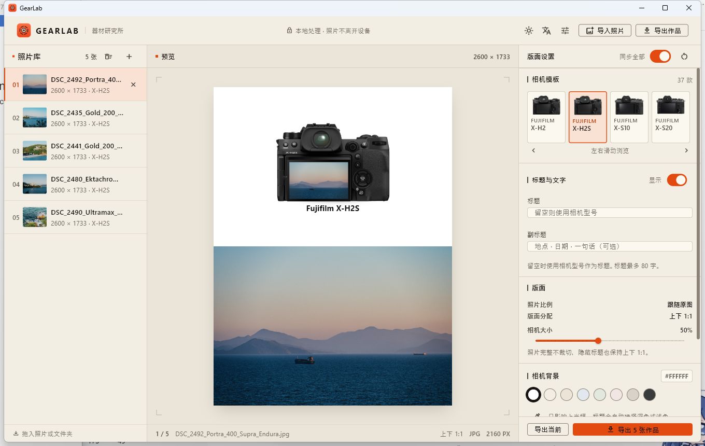
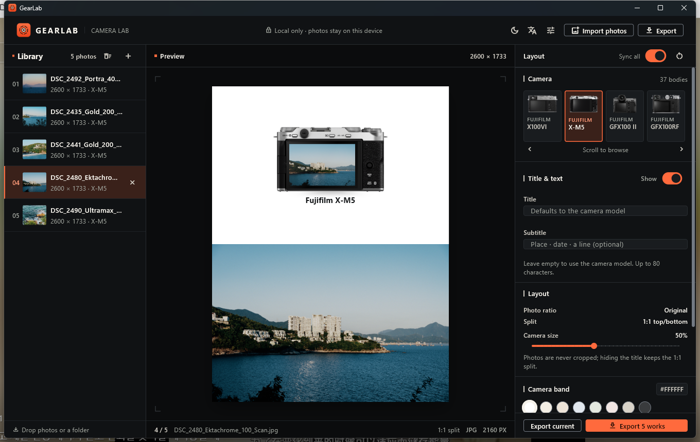
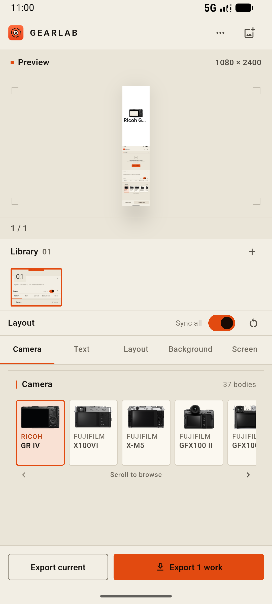
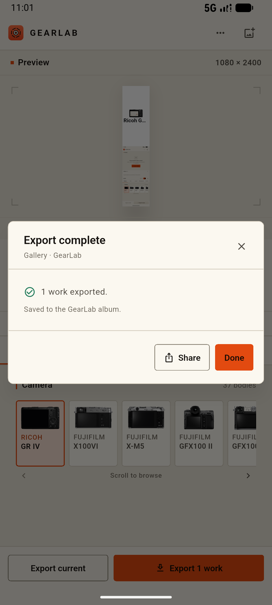

# GearLab UI 重构 · 方案与实施

> 状态：**已实施并通过本机验证**（2026-11-28）。本目录同时保留重构前的审计/规范/方案，以及实施后的验证记录。
>
> 基线：`85fb629 feat: 新增一些相机模板`（工作区原有的 `.github/workflows/macos.yml` 删除未触碰）
> 目标平台：Windows 10/11 x64、Android 7.0+/API 24+（以当前 Flutter 工程实际配置为准）
> 技术基线：Flutter 3.50.1 / Dart 3.14.0 / material_ui 1.11.1；`flutter analyze` 0 issue，16 项测试通过。

## 交付物

| 文件 | 内容 |
|---|---|
| [01-audit.md](01-audit.md) | 现状审计、量化证据、现有业务基线、问题分级、重构边界 |
| [02-design-system.md](02-design-system.md) | 设计方向、颜色/字体/间距/圆角/阴影/图标/动效 Token、组件状态、明暗、响应式与可访问性规范 |
| [03-refactor-plan.md](03-refactor-plan.md) | 重构范围与优先级、目标架构/目录、平台适配契约、状态 Schema v2、分阶段迁移与回滚 |
| [04-component-map.md](04-component-map.md) | 现有类 → 新组件映射、逐项改造清单、复用率与代码指标 |
| [05-test-acceptance.md](05-test-acceptance.md) | 基线固化、回归测试矩阵、手工验收清单、验收标准、风险与缓解 |
| [06-implementation.md](06-implementation.md) | 实施结果、架构落地、关键指标、真实构建/导出/截图验证、遗留风险 |
| [tokens.json](tokens.json) | 机器可读的两套语义色板与尺寸/字体 Token |
| [preview-desktop-light.png](preview-desktop-light.png) / [preview-desktop-dark.png](preview-desktop-dark.png) | 重构前 1440×900 桌面浅色/深色视觉预览（真实素材） |
| [preview-mobile-light.png](preview-mobile-light.png) / [preview-mobile-dark.png](preview-mobile-dark.png) | 重构前 390×844 Android 竖屏浅色/深色视觉预览（真实素材） |
| [preview.html](preview.html) | 预览源文件（可直接在浏览器打开） |

## 实施截图

| 桌面浅色 | 桌面深色 |
|---|---|
|  |  |

| Android 紧凑布局 | Android 导出结果 |
|---|---|
|  |  |

其他：[偏好设置](app-preferences.png) · [导出对话框](app-export-dialog.png) · [主题菜单](app-theme-menu.png) · [颜色选择器](app-color-picker.png)

## 一句话结论

现有产品能力完整，但 UI 层是 **2840 行单文件 + 单套硬编码深色主题 + 全中文硬编码字符串 + 全 14px 字号**；没有 Token、没有组件库、没有 i18n、没有平台适配层，响应式只判断了一次 `width >= 1000`。本次重构不是“换皮”，而是：

1. **先把设计系统立起来**：两套语义色板（浅色光桌 / 深色暗房）、完整的字阶/间距/圆角/阴影/图标/动效 Token；
2. **再拆应用壳与组件**：从 34 个 `main.dart` 私有类收敛到 22 个可复用 `Gl*` 组件，三栏桌面 → 两栏中型 → 单栏移动端，明暗随系统且可手动覆盖；
3. **同时把边界划清**：`presentation / domain / data / design / platform` 分层，Windows/Android 差异全部走适配层；
4. **每一步都锁定业务回归线**：海报像素 golden、v1 状态迁移、导出文件名/尺寸/gallery 行为、现有 catalog 测试全部保留。

## 视觉方向

**接触印样 / 光桌（contact sheet / light table）**：延续 `docs/examples` 里已有的纸感、墨色、安全橙、细分割线与编号式摄影编辑语言。浅色主题是“光桌”，深色主题是“暗房”；不是 SaaS 卡片套件，不做渐变玻璃，不做装饰性大写眉题。橙只用于“当前选中”和主操作，其余全部让位给照片与作品。

## 实施摘要

- Token/主题：`lib/design/tokens.dart`、`theme.dart`；`GlPalette` 两套 + `GlDensity` 双密度。
- 组件库：`lib/design/components.dart`，22 个 `Gl*` 组件。
- 应用壳：`bootstrap.dart` + `app/gearlab_app.dart` + `presentation/editor/*`，`main.dart` 仅 2 行。
- i18n：`lib/l10n` 中英 ARB，系统语言跟随 + 手动覆盖持久化。
- 平台适配：`lib/platform/*`，Windows 主机与 Android 各自实现；业务层无插件/IO 依赖。
- 状态 v2：新增 preferences，兼容 v1；海报渲染像素不变。
- 验证：`flutter analyze` 0 issue；`flutter test` 16/16；Windows Debug/Release、Android Release APK 构建成功；Windows 5 张批量导出与 Android 相册导出实测通过。

完整记录见 [06-implementation.md](06-implementation.md)。
