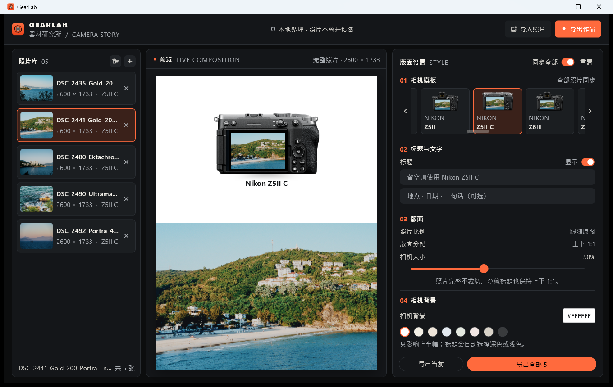
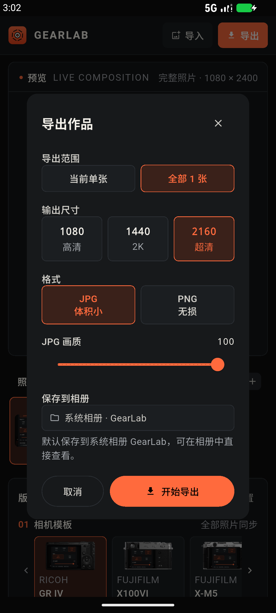

# GearLab · Flutter 工程

GearLab 相机排版工具的 Flutter 实现，版本 **1.0**。完整产品介绍、示例作品和下载见仓库根目录的 [README](../README.md)。





## 目录

```text
flutter_app/
  lib/
    main.dart         界面、导入/拖拽、设置、导出弹窗
    controller.dart   状态、图库、持久化、导出
    catalog.dart      37 款相机模板与屏幕区域
    renderer.dart     预览/导出共用的 1:1 合成渲染
    models.dart       照片、样式、导出模型
  assets/
    cameras/          透明相机模板
    app_icon.png
  docs/               界面截图
  windows/            Windows Runner（原生拖拽通道）
  android/            Android 工程
```

## 主要行为

- 上传照片后使用统一的 `paintPoster` 渲染预览与导出，上下区域严格 1:1。
- 照片完整展开，不裁切；相机屏幕区域使用模板归一化坐标。
- 默认导出全部照片、2160 超清、JPG 质量 100。
- Windows 固定写入解压目录外层的 `exports/`，不能更改目录；完成弹窗没有「打开目录」。
- Android 固定保存到系统相册 `Pictures/GearLab`；完成弹窗只有「关闭 / 分享」。
- Windows 主窗口启动居中。
- 导入照片会复制到应用图库目录，关闭应用后恢复上次照片、选中项与全部样式。
- Windows 状态与图库位于应用目录的 `userdata/`；Android 位于应用私有目录。

相机模板屏幕坐标在 `lib/catalog.dart` 的 `screen` 字段中维护。X-M5、Nikon Z8 与 Z5II C 的屏幕位置在 1.0 中做过微调；照片默认在屏幕内四周保留统一的 6% 内边距，Sony α7C II 与 Lumix S9 保持原屏幕满幅显示。

## 构建

```powershell
flutter pub get
flutter build windows --release
flutter build apk --release
```

环境：

- Flutter 3.50+ / Dart 3.14+
- Windows：Visual Studio 2022 C++ 桌面开发工具链、CMake、Ninja
- Android：Android SDK 36、JDK 17+

Windows 产物：`build/windows/x64/runner/Release/`
Android 产物：`build/app/outputs/flutter-apk/app-release.apk`

## 下载

- [Windows ZIP](../dist/GearLab-Flutter-Windows-1.0.zip)
- [Android APK](../dist/GearLab-Android-1.0.apk)

## 授权

相机模板由用户提供，商标归各自权利人所有。详见 [LICENSES](LICENSES.md)。
